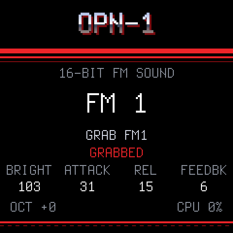
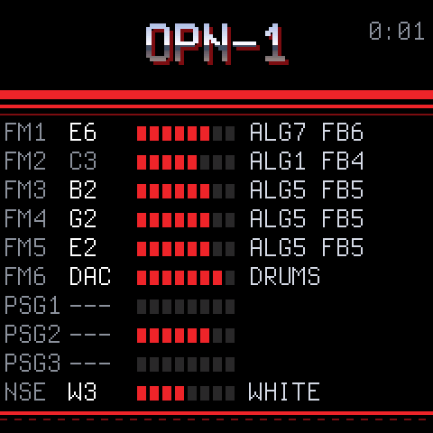
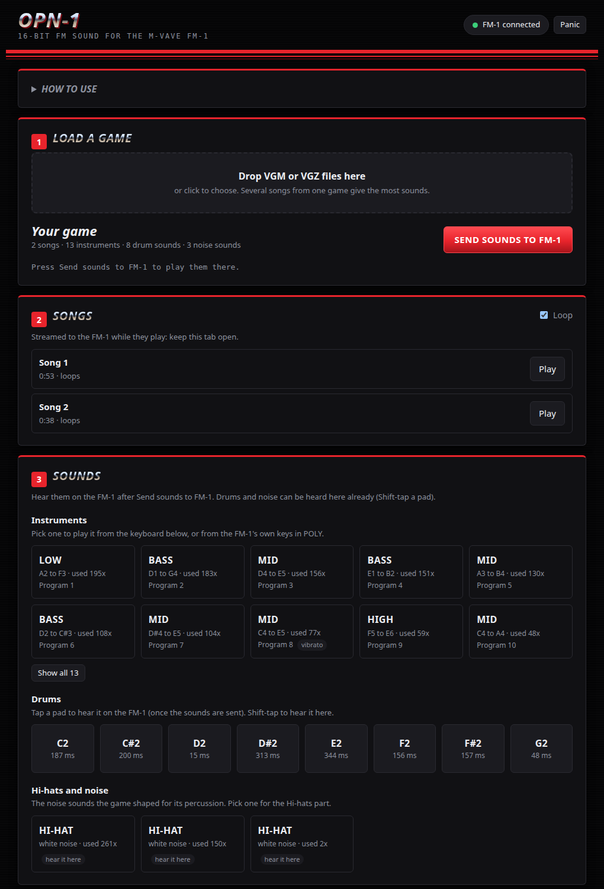

<p align="center"></p>

<p align="center"><b>The Mega Drive / Genesis sound chips as an instrument, on the M-VAVE FM-1.</b></p>

<p align="center"><a href="https://opn-1.putch.co.uk/"><b>Open the web app</b></a> (Chrome or Edge)</p>

<p align="center"><a href="https://opn-1.putch.co.uk/sample.mp3">Hear a sample</a>: a new song recorded from an FM-1 running OPN-1, with instruments from Sonic the Hedgehog</p>

OPN-1 is open-source firmware for the M-VAVE FM-1 keyboard. It runs accurate recreations of the console's
two sound chips, the Yamaha YM2612 (six FM channels plus a sample DAC) and the SN76489 PSG (three square waves and
a noise channel), and makes them playable from the FM-1's own keys and knobs, or over USB MIDI.

A companion web page loads a game's music files, pulls out the instruments, drums and noise sounds the game
used, and sends them to the FM-1, where they are kept in flash. The same page can stream the original songs to the
FM-1 and play them back exactly, with a live view of every channel on the device's screen.

<p align="center">
  
  
</p>

> **Status:** every feature below has been tested on a real FM-1. Installing it is at your own risk: see the
> [disclaimer](#disclaimer).

## Features

- **Accurate chips.** The YM2612 core is a C port of Aaron Giles' ymfm and matches it sample for sample in the
  tests; the PSG is a port of MAME's Sega PSG and matches it tick for tick. Both run in real time on the FM-1's CPU.
- **A game's sounds to play.** Drop VGM or VGZ files from one game onto the page. It finds the FM instruments (with
  their vibrato and LFO), the sampled drums and the shaped noise sounds, and sends them to the FM-1, which keeps the
  last set it was sent.
- **Songs, streamed.** Original VGM songs play on the FM-1 as the console played them, including DAC drums.
  Nothing is stored on the device: the page streams each song while it plays.
- **Played like a synth.** Six-voice POLY, any single chip channel, the drum kit or the noise from the keys. Knob
  pages for the sound, each operator's tone and envelope, the LFO, vibrato and a doubled detune, an arpeggiator,
  and SAVE to keep an edited sound.
- **See what a song does.** SEQ shows every channel's note, level and instrument in real time. REC grabs the sounds
  a song is playing right now onto the FM parts, ready to play.
- **MIDI over USB or the TRS jack.** GenMDM's layout (channels 1 to 6 FM, 7 to 9 square waves, 10 drums, 11 noise, with GenMDM's control
  changes), or a mode where any channel plays the part on the screen.

## Getting started

1. **Install the firmware** on the FM-1, as in [Installing the firmware](#installing-the-firmware) below.
2. **Open the page** in Chrome or Edge: **<https://opn-1.putch.co.uk/>**. To run it locally instead
   (Web MIDI needs https or localhost):

   ```sh
   cd web && python3 -m http.server 8000          # then open http://localhost:8000/
   ```

3. **Load a game.** Drop a few VGM or VGZ files from one Mega Drive game onto the page and press
   **Send sounds to FM-1**. Several songs from the same game give the most sounds. OPN-1 does not include any game
   music; use files you have the right to use.
4. **Play.** The page's **How to use** section explains every button and knob on the FM-1, the MIDI channels, and
   what to do when something goes wrong.

**Rescue:** if the FM-1 ever fails to start, hold **OCT-** while switching it on. It starts the USB updater only,
so a working firmware can be installed from there.


## Installing the firmware

You need the FM-1 plugged in over USB, Python 3, and two files in one folder:

- the `.fwsc` from the [latest release](https://github.com/putchdev/opn-1/releases/latest)
- the installer, [`fm1_install.py`](https://raw.githubusercontent.com/putchdev/opn-1/main/tools/fm1_install.py)
  (right click, Save link as)

Close anything else that talks to the FM-1 over MIDI first, including the OPN-1 page and any DAW. On Windows only
one program at a time can use it. In the commands below, use the name of the `.fwsc` you downloaded.

**Windows.** Install Python from [python.org](https://www.python.org/downloads/), ticking "Add python.exe to PATH".
Open Command Prompt in the folder with the two files and run:

```bat
py -m pip install mido python-rtmidi
py fm1_install.py opn1-1.0.0.fwsc
```

**macOS.** Install Python from [python.org](https://www.python.org/downloads/) (or `brew install python`). Open
Terminal in the folder with the two files and run:

```sh
python3 -m venv ~/.venv/fm1
~/.venv/fm1/bin/pip install mido python-rtmidi
~/.venv/fm1/bin/python fm1_install.py opn1-1.0.0.fwsc
```

**Linux.** On Debian or Ubuntu:

```sh
sudo apt install python3-mido python3-rtmidi
python3 fm1_install.py opn1-1.0.0.fwsc
```

On other distributions, use the macOS commands (Python's `venv` module may be a separate package).

The installer asks before it writes anything. The FM-1 then restarts into OPN-1 and shows its version on the screen.
`fm1_install.py --info` shows what the connected FM-1 runs. If an install is cut off, run the same command again and
it finishes.

To go back to the official firmware or another one, use the
[FM-1 Firmware Hub](https://fm1.designburgapps.com) in Chrome or Edge.
## Disclaimer

Installing OPN-1, or any custom firmware, on an M-VAVE FM-1 is done entirely at the owner's own risk. It may void
the device's warranty, and an interrupted or faulty install could leave it unusable. OPN-1 is provided "as is",
without warranty of any kind (see sections 15 and 16 of the [licence](LICENSE)). Its authors accept no
responsibility or liability for any damage to, or loss of use of, any device, or for any other loss arising from
installing or using it. If you are not comfortable with that, do not install it.

## Built with AI

OPN-1 was developed with the help of AI: much of its code, tests and documentation were written by Claude
(Anthropic) under the author's direction, then reviewed, tested on a real FM-1 and released by the author. It may
still contain mistakes; reports and fixes are welcome.

## Documentation

| | |
| --- | --- |
| [docs/MIDI.md](docs/MIDI.md) | The full MIDI protocol: playing, streaming songs, sending sound sets |
| [docs/DEVELOPING.md](docs/DEVELOPING.md) | Building, the host simulator, the accuracy tests, the code's layout |
| [docs/RULES.md](docs/RULES.md) | The FM-1 chip's rules and what the build checks for |
| [docs/API.md](docs/API.md) | What the platform layer gives the app |

<p align="center"></p>

## Credits

OPN-1 stands on the work of others:

- [Dinghy](https://github.com/zvenson/dinghy) by zvenson: the firmware base, host mode and build checks.
- [Felucca](https://github.com/hugelton/Felucca) by Leo Kuroshita (Hügelton Instruments), with the changes of
  [SLOOP](https://github.com/isod89/sloop-fm1) by isod89: the FM-1 platform (boot, USB, updates, audio, panel).
- [ymfm](https://github.com/aaronsgiles/ymfm) by Aaron Giles: the YM2612 emulation that `opn2.c` ports.
- [MAME](https://github.com/mamedev/mame)'s sn76496 by Nicola Salmoria and others: the PSG that `psg.c` ports.
- [Nuked-OPN2](https://github.com/nukeykt/Nuked-OPN2) by Nuke.YKT: a second reference in the tests.
- GenMDM: the MIDI layout OPN-1 follows.
- The Terminus font by Dimitar Zhekov.

## Licence

GPL-3.0-only: you may use, study, change and share OPN-1, and whoever receives a firmware built from it must be able
to get its source. Third-party parts keep their own licences; see [LICENSING.md](LICENSING.md).

OPN-1 is an independent project. It is not made, endorsed or supported by SEGA, Yamaha, M-VAVE, or the authors of
the projects above. Sega, Mega Drive and Genesis are trademarks of SEGA Corporation; M-VAVE and FM-1 belong to their
owners.
