<p align="center"></p>

<p align="center"><b>The Mega Drive / Genesis sound chips as a synth, on the M-VAVE FM-1.</b></p>

<p align="center"><a href="https://opn-1.putch.co.uk/"><b>Open the web app</b></a> (Chrome or Edge)</p>

<p align="center"><a href="https://opn-1.putch.co.uk/sample.mp3">Hear a sample</a>: a new song recorded from an FM-1 running OPN-1, with instruments from Sonic the Hedgehog</p>

OPN-1 is open-source firmware for the M-VAVE FM-1 keyboard. It runs accurate recreations of the console's
two sound chips, the Yamaha YM2612 (six FM channels plus a sample DAC) and the SN76489 PSG (three square waves and
a noise channel), and turns them into a synth you play from the FM-1's own keys and knobs, or over USB MIDI.

It holds a library of 128 FM patches in 4 banks of 32, like the FM-1's own firmware. The library starts empty: a
companion web app fills it from VOPM `.opm` patch files, or pulls the instruments out of a game's VGM music, and
lets you edit, audition and organise them. The same app can stream the original songs to the FM-1 and play them
back exactly, with a live view of every channel on the device's screen.

<p align="center">
  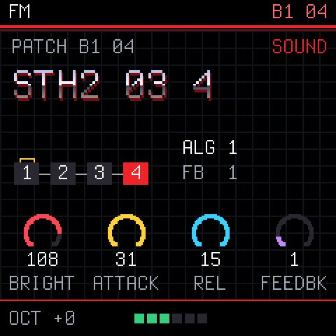
  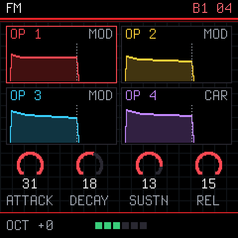
  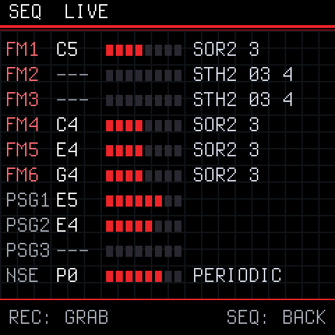
</p>

> **Still on OPN-1 1.x?** The web app above needs 2.0. The 1.0 page stays at
> <https://opn-1.putch.co.uk/v1/>, and 1.0.0 is on [the releases page](https://github.com/putchdev/opn-1/releases).
> Installing any version is at your own risk: see the [disclaimer](#disclaimer).

## Features

- **Accurate chips.** The YM2612 core is a C port of Aaron Giles' ymfm and matches it sample for sample in the
  tests; the PSG is a port of MAME's Sega PSG and matches it tick for tick. Both run in real time on the FM-1's CPU.
- **A patch library.** 128 slots in 4 banks of 32, kept in flash. PRESETS on the FM-1 steps through them and a
  MIDI program change picks one. Fill them from `.opm` banks (the VOPM format, as in the 2612.org packs) or from a game's VGM
  songs, into whichever bank and slot you pick, and export a bank back to `.opm`.
- **Single, Layer or Split.** Out of the box the FM-1 plays the selected patch, up to six notes at once.
  **Layer** stacks up to six patches on the keys, each at its own volume and playing with the note, after a delay
  or on release (an attack, a body and a tail). **Split** gives each MIDI channel its own patch, for a sequencer.
- **Edit on the device or the page.** Knob pages for the sound, each operator's tone, all four envelopes drawn,
  the LFO, vibrato and a doubled detune, and an arpeggiator. The web app's editor shows every operator and envelope
  at once and plays changes as you make them. SAVE keeps the patch in its slot.
- **A game's drums and noise.** VGM files give up their sampled drums and the shaped noise and square-wave sounds
  the game used, playable on channels 10 and 7 to 11.
- **Songs, streamed.** Original VGM songs play on the FM-1 as the console played them, including DAC drums.
  Nothing is stored on the device: the page streams each song while it plays.
- **Songs as MIDI.** The same songs can be turned into MIDI notes and patch changes in GenMDM's layout: played
  live on the FM-1 in GenMDM mode, or saved as a `.mid` file to open in a DAW. Close to the original, not exact.
- **See what a song does.** SEQ shows every channel's note, level and patch in real time. REC grabs the sounds a
  song is playing right now, ready to play.
- **MIDI over USB or the TRS jack.** By default the FM patch plays on channels 1 to 6 and 12 to 15, the square
  waves on 7 to 9, the drums on 10 and noise on 11. GenMDM's layout and control changes are a setting away.

## New in 2.0

1.0 played the last set of sounds the page sent from a game's music. 2.0 makes the FM-1 a patch-based synth:

- **A library instead of one sound set.** 128 patches in 4 banks of 32, picked with PRESETS or a program change.
  1.0 kept only the last game's sounds; on upgrading, they move into bank 1.
- **`.opm` patches as well as VGM.** Import VOPM banks (such as the 2612.org packs) into any bank and slot, and
  export a bank back to `.opm`.
- **Single, Layer and Split** replace 1.0's POLY and one-channel modes: one patch, up to six stacked (with delay and
  release triggers), or one per MIDI channel.
- **A full patch editor.** 1.0's editor set one FM channel's CCs; 2.0's draws every operator's envelope, edits a
  library patch and saves it back to its slot.
- **Redrawn FM-1 screens:** all four envelopes, one operator at a time, the setup, and a cleaner SEQ.
- **Songs as MIDI:** play a VGM song live in GenMDM mode, or save it as a `.mid` for a DAW.
- **A normal MIDI layout by default:** the patch on channels 1 to 6 and 12 to 15. GenMDM's layout is still a setting.
- **The page checks the firmware:** it works only with OPN-1 2.x. For 1.x, the 1.0 page stays at
  <https://opn-1.putch.co.uk/v1/>.

## The FM-1's screens

| | | |
| :---: | :---: | :---: |
|  | 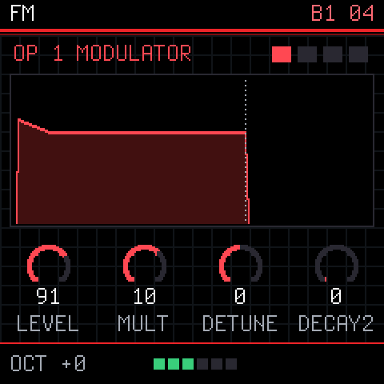 |  |
| **HOME:** the patch, its algorithm, the main knobs | **EDIT:** one operator, large. Again for the next | **ENV:** all four envelopes |
| 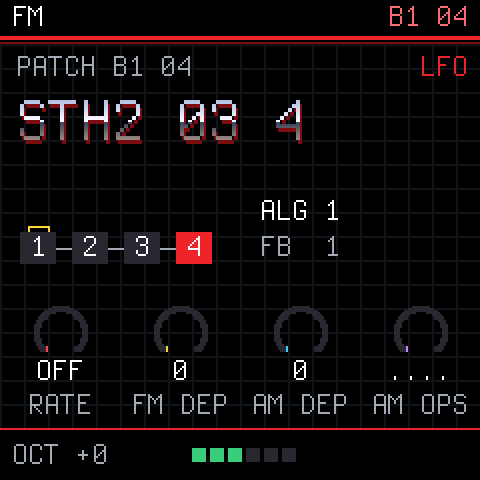 | 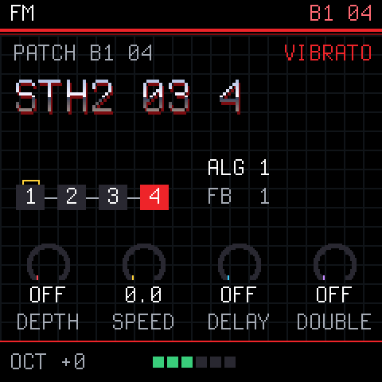 | 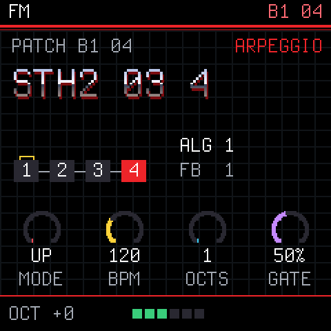 |
| **LFO:** rate, depths and which operators it moves | **FX:** vibrato and a doubled detune | **ARP:** the arpeggiator |
| 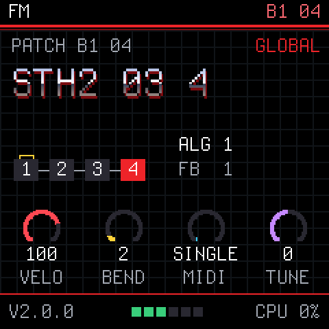 | 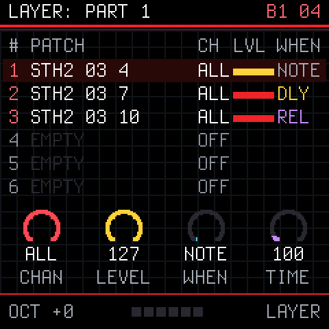 |  |
| **GLO:** velocity, bend range, MIDI mode, tuning | **GLO again:** SETUP, a layer's or split's parts | **SEQ:** every channel live |

## The web app

<p align="center">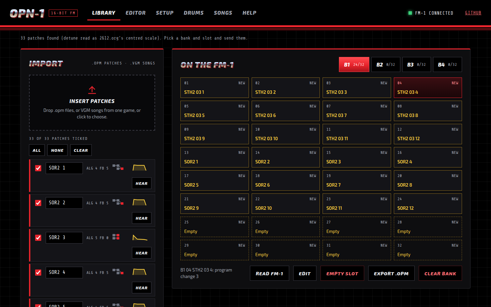</p>
<p align="center"><b>Library:</b> import <code>.opm</code> banks or VGM songs, tick the patches, pick a bank and slot, and send them.</p>

<p align="center">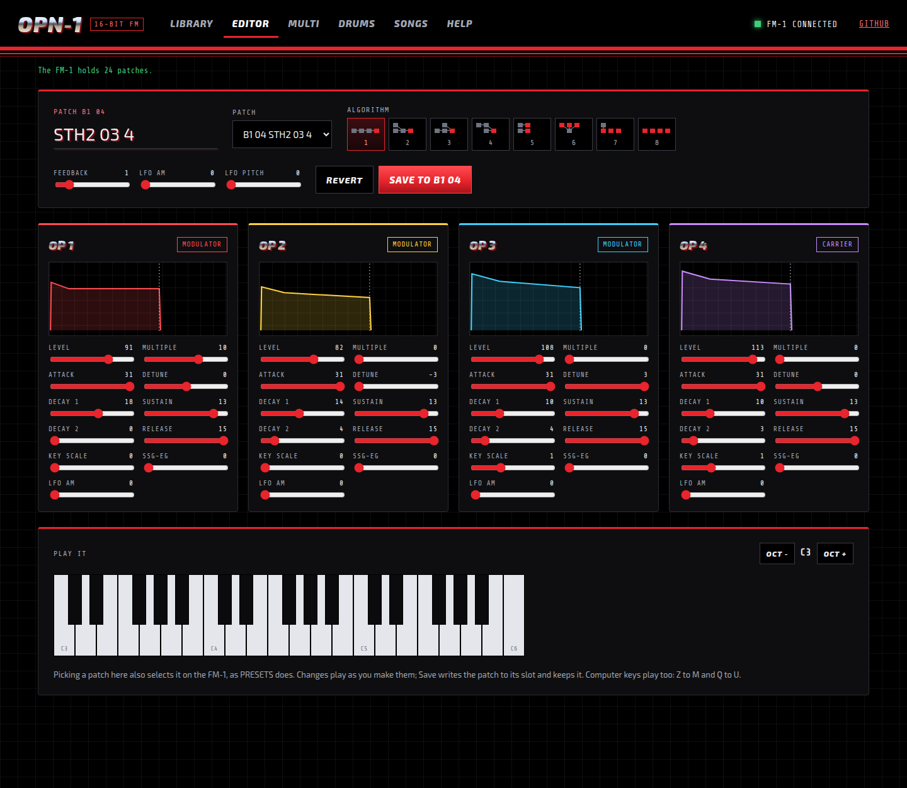</p>
<p align="center"><b>Editor:</b> pick a patch, change it and hear it on the FM-1 as you go, then save it to its slot.</p>

<p align="center">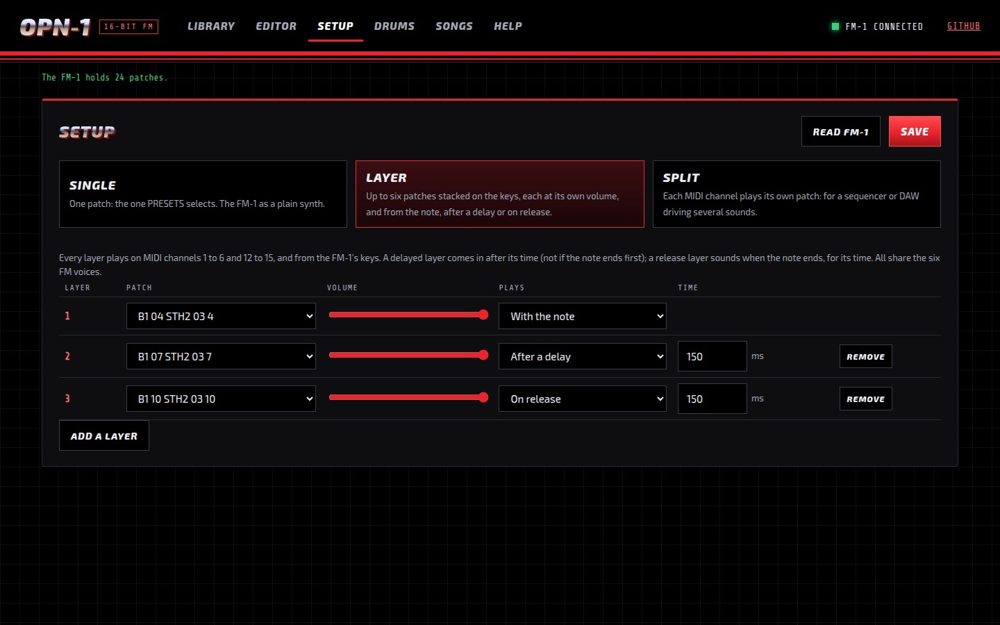</p>
<p align="center"><b>Setup:</b> Single, Layer or Split. A layer stacks patches on the keys; a split gives each MIDI channel its own.</p>

## Getting started

1. **Install the firmware** on the FM-1, as in [Installing the firmware](#installing-the-firmware) below.
2. **Open the web app** in Chrome or Edge: **<https://opn-1.putch.co.uk/>**. To run it locally instead
   (Web MIDI needs https or localhost):

   ```sh
   cd web && python3 -m http.server 8000          # then open http://localhost:8000/
   ```

3. **Fill the library.** In the Library, drop `.opm` files (or a few VGM or VGZ songs from one game), tick the
   patches you want, pick a bank and a start slot, and press **Send to FM-1**. OPN-1 does not include any game
   music or patches; use files you have the right to use.
4. **Play.** Turn PRESETS to step through the patches. The web app's **Help** tab explains every button and knob on
   the FM-1, and what to do when something goes wrong.

**Rescue:** if the FM-1 ever fails to start, hold **OCT-** while switching it on. It starts the USB updater only,
so a working firmware can be installed from there.


## Installing the firmware

You need the FM-1 plugged in over USB and Python 3. The commands below run from the OPN-1 project folder:

1. Get the project: **Code > Download ZIP** on GitHub and unzip it, or
   `git clone https://github.com/putchdev/opn-1.git`.
2. Download the `.fwsc` from the [latest release](https://github.com/putchdev/opn-1/releases/latest) into that
   folder. In the commands below, use the name of the file you downloaded.

Close anything else that talks to the FM-1 over MIDI first, including the OPN-1 page and any DAW. On Windows only
one program at a time can use it.

**Windows.** Install Python from [python.org](https://www.python.org/downloads/), ticking "Add python.exe to PATH".
Open Command Prompt in the project folder and run:

```bat
py -m pip install mido python-rtmidi
py tools\fm1_install.py opn1-2.0.0.fwsc
```

**macOS.** Install Python from [python.org](https://www.python.org/downloads/) (or `brew install python`). Open
Terminal in the project folder and run:

```sh
python3 -m venv ~/.venv/fm1
~/.venv/fm1/bin/pip install mido python-rtmidi
~/.venv/fm1/bin/python tools/fm1_install.py opn1-2.0.0.fwsc
```

**Linux.** On Debian or Ubuntu:

```sh
sudo apt install python3-mido python3-rtmidi
python3 tools/fm1_install.py opn1-2.0.0.fwsc
```

On other distributions, use the macOS commands (Python's `venv` module may be a separate package).

The installer asks before it writes anything. The FM-1 then restarts into OPN-1 and shows its version on the screen.
`tools/fm1_install.py --info` shows what the connected FM-1 runs. If an install is cut off, run the same command
again and it finishes.

To go back to the official firmware or another one, use the
[FM-1 Firmware Hub](https://fm1.designburgapps.com) in Chrome or Edge.

## Disclaimer

Installing OPN-1, or any custom firmware, on an M-VAVE FM-1 is done entirely at the owner's own risk. It may void
the device's warranty, and an interrupted or faulty install could leave it unusable. OPN-1 is provided "as is",
without warranty of any kind (see sections 15 and 16 of the [licence](LICENSE)). Its authors accept no
responsibility or liability for any damage to, or loss of use of, any device, or for any other loss arising from
installing or using it. If you are not comfortable with that, do not install it.

## Built with AI

OPN-1 was developed with the help of AI: much of its code, tests and documentation were written by Claude
(Anthropic) under the author's direction, then reviewed, tested on a real FM-1 and released by the author. It may
still contain mistakes; reports and fixes are welcome.

## Documentation

| | |
| --- | --- |
| [docs/MIDI.md](docs/MIDI.md) | The full MIDI protocol: playing, setups, the library, songs as MIDI, streaming |
| [docs/DEVELOPING.md](docs/DEVELOPING.md) | Building, the host simulator, the accuracy tests, the code's layout |
| [docs/RULES.md](docs/RULES.md) | The FM-1 chip's rules and what the build checks for |
| [docs/API.md](docs/API.md) | What the platform layer gives the app |

## Credits

OPN-1 stands on the work of others:

- [Dinghy](https://github.com/zvenson/dinghy) by zvenson: the firmware base, host mode and build checks.
- [Felucca](https://github.com/hugelton/Felucca) by Leo Kuroshita (Hügelton Instruments), with the changes of
  [SLOOP](https://github.com/isod89/sloop-fm1) by isod89: the FM-1 platform (boot, USB, updates, audio, panel).
- [ymfm](https://github.com/aaronsgiles/ymfm) by Aaron Giles: the YM2612 emulation that `opn2.c` ports.
- [MAME](https://github.com/mamedev/mame)'s sn76496 by Nicola Salmoria and others: the PSG that `psg.c` ports.
- [Nuked-OPN2](https://github.com/nukeykt/Nuked-OPN2) by Nuke.YKT: a second reference in the tests.
- GenMDM: the MIDI layout OPN-1 follows.
- The Terminus font by Dimitar Zhekov.

## Licence

GPL-3.0-only: you may use, study, change and share OPN-1, and whoever receives a firmware built from it must be able
to get its source. Third-party parts keep their own licences; see [LICENSING.md](LICENSING.md).

OPN-1 is an independent project. It is not made, endorsed or supported by SEGA, Yamaha, M-VAVE, or the authors of
the projects above. Sega, Mega Drive and Genesis are trademarks of SEGA Corporation; M-VAVE and FM-1 belong to their
owners.
